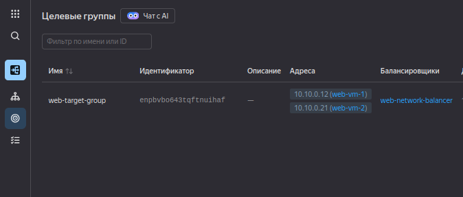
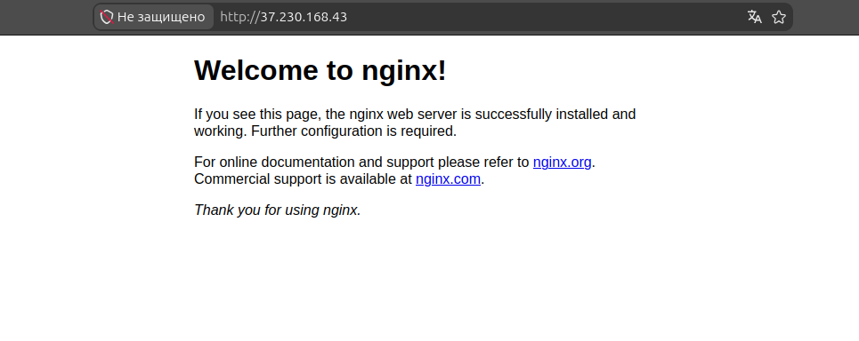

# fault-tolerance
Отказоустойчивость в облаке

# Домашнее задание: Отказоустойчивость (fault-tolerance)

## Задание
создать 2 идентичные виртуальные машины. Используйте аргумент count для создания таких ресурсов;
создать таргет-группу. Поместите в неё созданные на шаге 1 виртуальные машины;
создать сетевой балансировщик нагрузки, который слушает на порту 80, отправляет трафик на порт 80 виртуальных машин и http healthcheck на порт 80 виртуальных машин.

Установите на созданные виртуальные машины пакет Nginx любым удобным способом и запустите Nginx веб-сервер на порту 80.

Перейдите в веб-консоль Yandex Cloud и убедитесь, что:

созданный балансировщик находится в статусе Active,
обе виртуальные машины в целевой группе находятся в состоянии healthy.

Сделайте запрос на 80 порт на внешний IP-адрес балансировщика и убедитесь, что вы получаете ответ в виде дефолтной страницы Nginx.

В качестве результата пришлите:

1. Terraform Playbook.

2. Скриншот статуса балансировщика и целевой группы.

3. Скриншот страницы, которая открылась при запросе IP-адреса балансировщика.

### 1. Terraform Playbook
Код конфигурации находится в папке [`terraform/`](terraform/).

### 2. Скриншот статуса балансировщика и целевой группы

### 3. Скриншот страницы Nginx
